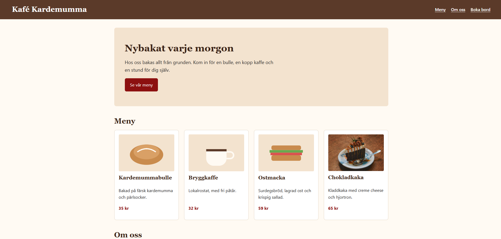
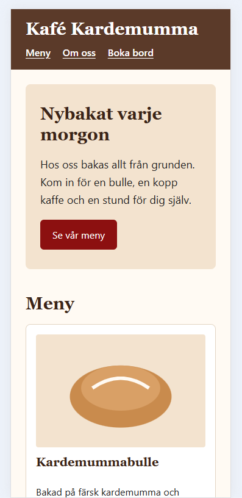

# Min webbplats – Kafé Kardemumma

Det här är en webbplats som jag har skapat som en del av utbildningen UI/UX & Frontendutveckling på Lexicon IT-Proffs. Webbplatsen presenterar ett kafé med två sidor som innehåller en meny, information om kaféet och dess ägare samt ett formulär för bordsbokning.

## Live-sida

Öppna min webbplats här: https://norsestellar.github.io/camilla-m4-dag10-github-och-publicering/

## Tekniker

Jag har använt följande tekniker:

- HTML5 – för webbplatsens struktur.
- CSS3 – för design, layout och responsivitet.
- Git och GitHub – för versionshantering och publicering.

## Skärmbilder

### Desktop

### Mobil

